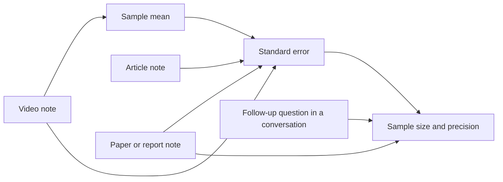

# My Second Brain

[简体中文](README.md) | English

My Second Brain is a local knowledge-base template for Obsidian and Codex. It connects concepts you learn from different sources. A video can contribute several concepts; when an article, paper, or conversation covers one of them again, its explanation goes into the existing concept page, with a reference back to the source.

You can also use the network to decide what to study next. During a review, Codex looks for missing prerequisites and methods that connect existing concepts, then writes notes you can study. Choose a suggestion, work through it with Codex, and use exercises and review cards to revisit what you have learned.

The example notes, guides, and saved prompts are currently in Chinese. You can ask Codex to explain them in English and write new notes in your preferred language.

## How a video connects to other sources

Suppose you watch a 20-minute video on Bilibili or YouTube about why estimates tend to become more stable with larger samples. Give Codex a transcript with timestamps, and it can keep a video note with references to the relevant moments while extracting separate pages for the sample mean, standard error, and the relationship between sample size and precision.

Later, you read a post on X or WeChat that also explains standard error. Its example can go into the existing page. A research paper can add assumptions and results. If you ask GPT why a step in a formula works, you can check the derivation and keep that explanation on the same page.

Opening the standard error page then gives you several explanations and the conditions under which each applies. Opening the video note gives you links to the concepts covered in that video.

The [statistical estimation example](MOCs/统计估计.md) contains a small network like this. Its source article, transcript, report, and conversation are synthetic teaching materials included in the repository.

## Finding something new to learn in existing notes

Suppose you have studied standard error and sample size, along with paired evaluation: comparing two methods on the same set of questions. Each topic involves assumptions about whether observations are independent. In paired evaluation, the observations are the score differences across questions.

If your notes cover only independent observations, a review can lead to a suggestion: study correlated sampling. How should you calculate uncertainty when observations are related? The suggestion comes from a gap shared by several pages, so you do not need to know the name of the missing concept in advance.

The [correlated sampling note](待学概念/数理基础/相关抽样.md) starts with a question:

> If you duplicate every observation, the number of rows doubles. Does the estimate become more precise? If two test questions are rewordings of the same question, do they count as two independent pieces of evidence?

The note explains how observations varying together affect uncertainty, then works through the duplicate-record example. Ask Codex to walk you through it and give you a variation to solve. Your answer guides the next step: explain a difficulty, update the concept pages with what you have learned, or prepare review cards. Questions that come up during review can lead to further changes in the notes.

This gives you a way to learn from the network even when you have no new video or article to add. You can accept, defer, or skip a suggestion. Progress is recorded from your explanations, derivations, and applications; generating a note alone does not count as learning it.

## Try it with Obsidian and Codex

The project is a local folder containing example notes, instructions for the AI assistant, and a few tools. The notes are Markdown files. Use Obsidian to read and edit them, Codex to process materials and discuss questions, and a local web page to review cards.

1. Download or clone this repository. Open the project folder as a vault in Obsidian, and open the same folder in Codex.
2. Open the [knowledge index](MOCs/知识库入口.md) in Obsidian and follow a few links between concepts.
3. Send this prompt to Codex to try learning from the existing network:

> Read README.en.md and AGENTS.md. Find the assumptions about independent observations in the notes on standard error (标准误), sample size and precision (样本量与精度), and paired evaluation (配对评测). Explain why correlated sampling (相关抽样) would be a useful next topic. Teach me in English, starting with the duplicate-record example. Give me a variation and wait for my answer before continuing. Update the concept pages based on what I actually understand, then prepare review cards after we have worked through the topic.

The repository currently has 15 concept pages and one suggested topic to study:

| Reading path | Concepts and relationships |
| --- | --- |
| [Statistical estimation](MOCs/统计估计.md) | Sample mean, standard error, sample size and precision, then correlated sampling |
| [Information and prediction](MOCs/信息与预测.md) | Entropy, cross-entropy, KL divergence, and perplexity |
| [Text encoding and tokenization](MOCs/文本编码与分词.md) | UTF-8, byte-level BPE, reversible decoding, and how tokenization affects perplexity |
| [Research and experiments](MOCs/研究与实验.md) | Testable questions, near-counterexamples, ablation studies, and paired evaluation |

Text beside the links explains how the concepts relate. Obsidian's local graph can also show which notes connect to a page.

## Everyday use

Give Codex a link, text, transcript, or selected conversation, along with the question you want to understand. For example:

> Help me work through this video. I want to understand when adding data improves an estimate. Add the relevant concepts to my existing network, keep the sources, and check whether there is anything I should study next.

The [material intake prompt](Prompts/整理材料.md) covers this task. The [review and further learning prompt](Prompts/回顾与补学.md) checks the existing network for missing prerequisites, unexplained relationships, and methods that could apply to other problems. Once you choose a suggestion, use the [guided learning prompt](Prompts/带学新概念.md) for explanation and exercises.

You start these tasks in Codex. Looking for further learning is part of the intake and review instructions. You can set up a schedule in your own environment if you want regular runs; the template does not install background tasks.

For cards, use the [daily review prompt](Prompts/每日复习.md). Try to recall the answer before revealing the explanation and sources. At the end, click “导出反馈文件” (export feedback file) in the browser and give the file to Codex to import. Feedback affects later review schedules once it has been saved. Generating the review page requires Python 3.9 or later. Codex can check the environment and run the commands described in the [tool guide](Guides/工具与扩展.md).

To start with your own material, ask Codex to create a separate, empty learning folder that keeps the guides and tools. Books, courses, and practical work can also be included; see [other sources](Guides/其他来源.md). How much text, transcript, or image content can be read from a link depends on the tools you use. Missing material needs to be provided or retrieved separately.

## Why I made this

I use Codex with my own Obsidian vault to organize what I learn from different places. Conversations with GPT are a major source, and I wanted to bring videos, articles, papers, and other learning materials into the same process. When a concept comes up again, I can add to my existing understanding. When I revisit those concepts, I can look for what to study next.

My Second Brain collects the guides, examples, and local tools behind that process. The information theory, text encoding, and research methods examples were adapted from parts of my private vault. They retain the concept relationships, with private conversations, personal experiences, and learning records removed. See [sources and licensing](THIRD-PARTY.md) for details.

## Other setups and extensions

You can use Codex with another Markdown editor, or Obsidian with another AI assistant that can access local files and follow the project guides. With just an editor and browser, you can maintain concepts and links manually and run the Python review tools. Finding new concepts and working through them requires your own work or an AI assistant you connect separately.

Notes use Obsidian links such as `[[Concepts/数理基础/标准误|标准误]]`. In an editor that does not support these links, open the `.md` file at the path before the vertical bar. The card interface displays source excerpts directly.

The AI assistant writes content and teaches from the project guides. Local scripts check links and card sources, generate review sets, and save feedback. They use the Python standard library and a bundled copy of KaTeX, with no server or Obsidian plugin required. Review uses adjustable fixed intervals; its effect on learning has not been evaluated. The [tool guide](Guides/工具与扩展.md) explains how to change folders, source types, and review settings.

Personal review records are stored in `.flashcards/local/`; cached source text and processing records belong in `.local/`. Include both in your backups. Git ignores these directories, but check the notes themselves for private content before sharing a vault.

This is an early public version. A license for the project's own material has not yet been chosen. Third-party components retain their existing licenses.
