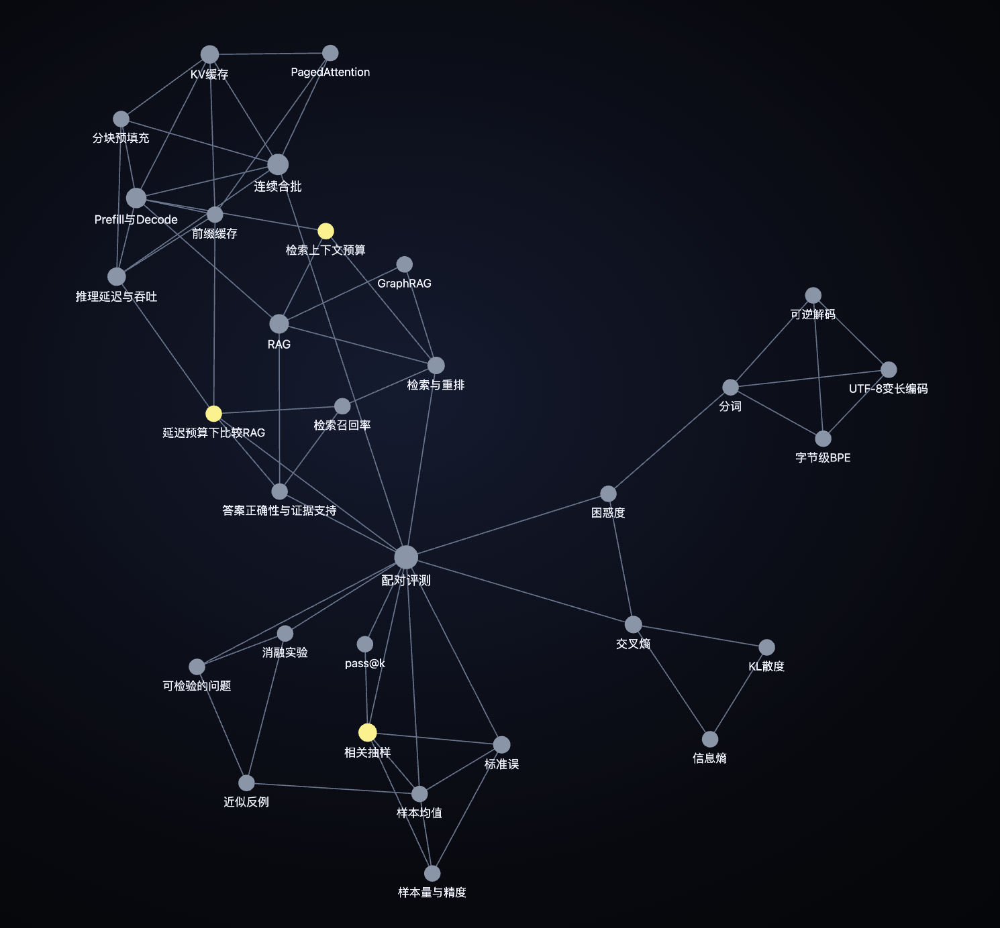

# My Second Brain

[简体中文](README.md) · English · [MIT](LICENSE)

Keep your notes in Obsidian and study with Codex. Add explanations from videos, papers, or conversations to the same concept note. Codex can follow the links between notes to suggest what to study next.

[First-use guide](Guides/First-Run.md) · [Browse the example notes](MOCs/知识库入口.md)

Blue-gray is for existing concepts and pale gold is for AI study suggestions. [Comparing RAG under a latency budget](待学概念/模型评测/延迟预算下比较RAG.md) puts retrieval recall, answer quality, and wait time into one exercise. [Open the graph in Obsidian](Guides/Graph-View.md)

## Try it with your own material

On GitHub, choose **Code → Download ZIP**, then unzip it. Open the same folder in Obsidian and Codex. Give Codex a source and a question you want to answer.

> Read AGENTS.md. Help me answer my question using this source. Add explanations I can reuse to the concept notes and keep the sources. Suggest a follow-up question if you find one worth studying.

The sample [video](Videos/抽样次数与误差.md) and [article](Articles/重复抽样与标准误.md) contribute to the same [standard error note](Concepts/数理基础/标准误.md). Both are synthetic and assume independent observations. That assumption led Codex to suggest [correlated observations](待学概念/数理基础/相关抽样.md). If you duplicate every row in a dataset, does the mean's standard error shrink? Work it out, then have Codex help where you get stuck and make a review card. [Try the full example](Guides/First-Run.md)

## Use the tools you have

The same questions kept turning up in papers, courses, and chats. I wanted one page I could come back to, with the sources still there. [Periodic review](Guides/Automation.md)

The notes are local Markdown. Use your own editor, source reader, or AI assistant with file access. The review tool uses Python 3.9 or later to generate a page you can open offline. The sample notes and review interface are in Chinese. [Sources and tools](Guides/Sources-and-tools.md) · [Add sources or change review settings](Guides/工具与扩展.md)

Code, templates, and examples are [MIT licensed](LICENSE). [Third-party components and imported material](THIRD-PARTY.md) have their own licenses. If you run into a problem, [open an issue](https://github.com/beetlespike/My-Second-Brain/issues) with a public or synthetic example.
