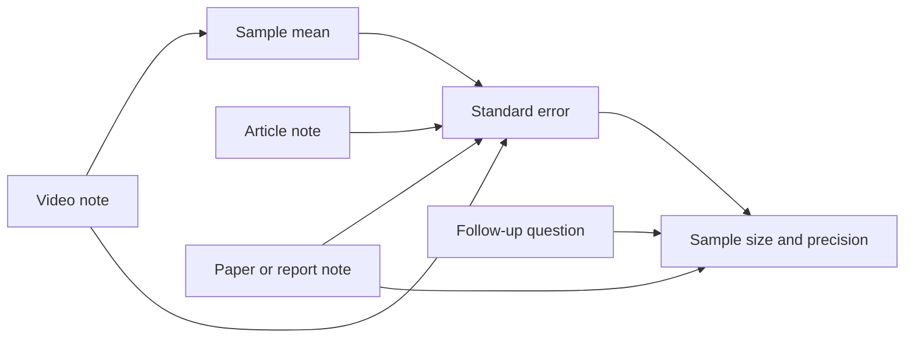

# My Second Brain

[简体中文](README.md) | English · [MIT](LICENSE)

My Second Brain is a local knowledge-base template for Obsidian and Codex. It connects concepts from videos, articles, papers, conversations, and practical work. One source can contribute several concepts; several sources can add to the same concept page.

The network can also give you something new to study. During organization or review, the AI looks for missing prerequisites and methods between existing concepts and writes study notes. Choose a topic, work through an explanation or exercise, then revisit it with review cards.

## From sources to a concept network

Suppose you watch a 20-minute video on Bilibili or YouTube about why larger samples tend to make estimates more stable. Organizing the transcript can produce a video note with timestamps and separate pages for the sample mean, standard error, and sample size and precision.

Later, an article on X or WeChat, or a research paper, covers the same formula. Its examples and assumptions can go into the existing concept page. A derivation you discussed with GPT can join them once checked.

The standard error page brings together explanations and their conditions. The video note links to the concepts it covers. Try the [statistical estimation example](MOCs/统计估计.md); its source texts, transcript, and conversation are synthetic teaching materials.

## Learning from the network

Standard error, sample size and precision, and paired evaluation all involve assumptions about independence between observations. If the notes cover only independent observations, a review can suggest correlated sampling to fill the shared gap.

The [suggested study note](待学概念/数理基础/相关抽样.md) asks: if you duplicate every observation, does doubling the row count make the estimate more precise? It includes an explanation and calculation. You can also ask Codex for a variation to solve, without knowing the missing concept's name in advance.

What you learn joins the concept network; useful questions become review cards. Questions during review can lead to changes in the notes. You can continue learning this way without adding a new source, or defer a suggestion. Progress is recorded from your explanations, derivations, or applications.

## Getting started

Download or clone the repository and open the same folder in Obsidian and Codex. Read and edit notes in Obsidian, organize materials and discuss questions in Codex, and open a local HTML page for card review.

Browse the [knowledge index](MOCs/知识库入口.md), or give Codex your own material:

> Read AGENTS.md and help me organize this material. My question is… Add its concepts to the existing network, keep the sources, and look for something worth studying next. Explain and write notes in English.

For a complete walkthrough, see [First use](Guides/First-Run.md). Adapt the prompts, materials, and study order to your needs.

| Example path | Topics |
| --- | --- |
| [Statistical estimation](MOCs/统计估计.md) | Sample mean, standard error, sample size and precision, correlated sampling |
| [Information and prediction](MOCs/信息与预测.md) | Entropy, cross-entropy, KL divergence, perplexity |
| [Text encoding and tokenization](MOCs/文本编码与分词.md) | UTF-8, byte-level BPE, reversible decoding, tokenization and perplexity |
| [Research and experiments](MOCs/研究与实验.md) | Testable questions, near-counterexamples, ablations, paired evaluation |

There are 15 concept pages and one suggested study note. The examples and saved prompts are in Chinese; Codex can explain them and write new notes in your preferred language. Prompts cover [intake](Prompts/整理材料.md), [further learning](Prompts/回顾与补学.md), [guided study](Prompts/带学新概念.md), and [review](Prompts/每日复习.md).

## Tools for reading materials

The repository includes note guides, examples, link checks, and card tools. Your environment supplies web access, subtitle extraction, PDF parsing, and conversation history. The AI then organizes what it can read into notes and concepts.

[Sources and tools](Guides/Sources-and-tools.md) offers an optional selection: yt-dlp for subtitles, Whisper for audio, Trafilatura for ordinary web pages, and Docling or MinerU for PDFs. You can use your own tools or provide text, transcripts, and selected conversations directly. These extractors are not bundled; connect them as needed.

The local tools need Python 3.9 or later and use its standard library plus bundled KaTeX. No server or Obsidian plugin is required. See the [tool guide](Guides/工具与扩展.md) for commands and settings. Cards use adjustable fixed review intervals; their effect on learning has not been evaluated.

## Periodic organization and maintenance

In my personal vault, I periodically organize authorized Codex and ChatGPT learning conversations and review the relationships between concepts. This relies on history access and local file access in my current desktop environment. Other clients may need exports or manually supplied excerpts.

[Automation and maintenance](Guides/Automation.md) describes this practice, adaptable prompts, and alternatives, along with a separate task for maintaining the public repository. Choose a cadence that suits you. Downloading the template does not create scheduled tasks or read account history.

## Background and other setups

This project grew out of my private Obsidian vault. I wanted concepts from different sources to build on one another and help me find what to study next. Some examples were adapted from that network, with private conversations, experiences, and learning records removed. See [sources and licensing](THIRD-PARTY.md).

You can pair Codex with another Markdown editor, or Obsidian with another AI assistant that can access local files. Manual editing also works. Folders and source types can be extended; see [other sources](Guides/其他来源.md). In editors without Obsidian link support, open the `.md` file at the path shown in the link.

The project's own code, templates, documentation, and examples use the [MIT License](LICENSE). Third-party components and materials you import retain their own rights and licenses. Back up personal review records in `.flashcards/local/` and source caches and processing records in `.local/`. Git ignores both directories; also check note contents for private information before sharing your vault.
