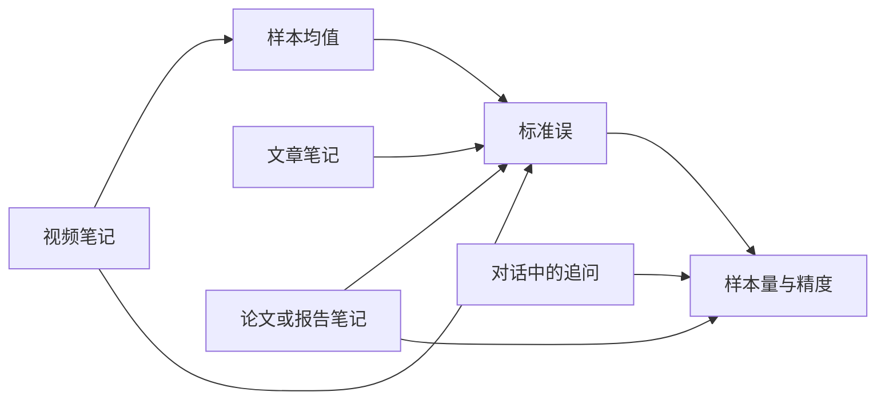

# My Second Brain

My Second Brain is a local knowledge-base template for learning across videos, articles, papers, and conversations. It connects reusable concepts across sources and uses those connections to suggest further learning, with guided explanations and review cards. Open the same folder in Obsidian and Codex; start with the [example network](MOCs/知识库入口.md).

你在 B 站或 YouTube 上看完一段 20 分钟的视频，觉得里面几个概念讲得很好。过几天，喜欢的博主在 X 或微信公众号上又发了一篇相关文章。做研究时，还可能遇到一篇论文，把同一个问题讲得更深入。与 GPT 的讨论，则常常让你发现自己之前漏掉了什么。

这些来源可以共同完善一份理解。一个视频里可能有好几个值得学的概念；同一个概念，也可能同时得到视频中的例子、文章中的解释、论文中的证据，以及你在对话里的追问。

My Second Brain 用 AI 把这些概念提炼出来，连成可以继续学习的知识网络。AI 还会沿着已有概念寻找缺少的前提和方法，把你可能还没学过、却与现有知识密切相关的内容写成待学页，再通过讲解、练习和知识卡片帮助你理解、记住它。这样，知识库本身也能成为你的知识来源。

## 一份材料怎样进入知识网络

假设一个视频讲“为什么样本越多，估计通常越稳定”。整理时，AI 会留下视频笔记和时间戳，并从中提炼出“样本均值”“标准误”“样本量与精度”几个概念。

后来读到一篇也在讲标准误的文章，它的解释和例子会补到已有的“标准误”页面。再读论文时，论文采用的条件和实验结果也可以接到这里。概念页由不同来源共同完善，每条重要解释仍能回到出处核对。视频笔记也可以同时连接多个概念。

仓库里的[统计估计示例](MOCs/统计估计.md)可以直接展示这种关系：

阅读时，你既可以从一份材料进入几个概念，也可以从一个概念回看不同来源怎样解释它。新的材料进来以后，已有的解释会继续补充、修正。

## 已有知识还能带你学什么

网络中的联系会暴露出新的问题。例如，你已经学过“标准误”和“样本量与精度”，也接触过用一批题比较两种方法的“配对评测”。这几处都涉及同一个条件：观察结果是否彼此独立。

AI 回顾这些页面时，可以发现一个值得补上的概念：相关抽样。它会说明这个概念为什么出现在这里，并给你一个能接着想的问题：

> 把同一条观测复制一遍，数据行数翻倍，估计就会更准吗？如果两道测试题只是同一道题的改写，它们算两份独立证据吗？

[相关抽样](待学概念/数理基础/相关抽样.md)就是这样的待学页。它连接已有概念，解释协方差怎样影响误差，并用重复记录的例子给出完整计算。AI 可以带你读这一页，让你换个例子试算，再根据你的解释继续补充。

学过以后，新概念会接入原有网络，有价值的问题可以做成卡片复习。复习时暴露出的疑问又会回到概念页。即使这次没有带来新的视频或文章，也可以从库里已有知识之间的联系开始学习。

你可以接受某个建议，也可以搁置。库里出现了一个概念，不代表你已经学会；判断学习进展仍要看你的说明、解释、推导或实际应用。

## 在 Obsidian＋Codex 中试一遍

这是一个本地知识库文件夹，推荐让 Obsidian 和 Codex 打开同一个目录。Obsidian 用来读笔记、沿链接探索和手动修改；Codex 负责整理材料、发现值得补学的内容，并与你讨论。浏览器里的网页只承担翻卡复习，知识正文保存在 Markdown 文件中。

先在 Obsidian 打开[知识库入口](MOCs/知识库入口.md)，再把下面这段话发给同目录中的 Codex：

> 请读 README.md 和 AGENTS.md，带我体验知识网络怎样反过来帮助学习。先从“标准误”“样本量与精度”和“配对评测”找出它们共同依赖的条件，说明为什么值得继续学“相关抽样”。从重复记录的例子开始讲，给我一道变式，等我回答后再继续。根据我的实际理解完善这条知识联系，学习后再准备适合复习的卡片。

也可以从其他路径开始：

| 阅读路径 | 可以沿着哪些关系读下去 |
| --- | --- |
| [统计估计](MOCs/统计估计.md) | 样本均值、标准误、样本量与精度，再到相关抽样 |
| [信息与预测](MOCs/信息与预测.md) | 信息熵、交叉熵、KL 散度与困惑度 |
| [文本编码与分词](MOCs/文本编码与分词.md) | UTF-8、字节级 BPE、可逆解码，以及分词怎样影响困惑度 |
| [研究与实验](MOCs/研究与实验.md) | 可检验的问题、近似反例、消融实验与配对评测 |

这几条路径目前有 15 篇正式概念页和一篇待学页。页面之间的链接会解释彼此的关系，Obsidian 的局部关系图也能帮助你浏览。

## 日常怎样用

有新材料时，给 Codex 链接、正文、字幕或选定的对话，再告诉它你关心什么。例如：

> 帮我整理这个视频。我想弄清它说的“增加数据能改善估计”在什么条件下成立。把涉及的概念补进现有网络，保留来源，再看看它和我已有的知识之间有没有值得继续学的问题。

[整理材料](Prompts/整理材料.md)负责这类工作。[回顾与补学](Prompts/回顾与补学.md)则可以直接从已有网络出发，找共同缺失的前提、尚未解释的联系或能迁移到别处的方法。你选中一项后，用[带学新概念](Prompts/带学新概念.md)进入讲解和练习。

整理与回顾过程中，Codex 按指南主动寻找这些内容，你无需先说出新概念的名字。想让它定期回顾，可以在自己的环境中设置定时任务；当前模板没有安装后台任务。

复习时使用[每日复习](Prompts/每日复习.md)。先回想，再翻面看解释和来源。普通浏览器会导出反馈文件，把它交给 Codex，确认保存后才会影响后续复习安排。生成卡片需要 Python 3.9 或以上，环境检查和具体命令可以交给 Codex，见[工具与扩展](Guides/工具与扩展.md)。

想用自己的内容从空白开始，也可以让 Codex 在旁边初始化一份空白学习目录，保留指南和工具。视频、文章、论文、对话以外的来源同样可以接入；书籍、课程与实践记录的做法见[其他来源](Guides/其他来源.md)。网页、图片、字幕或论文能读到多少，以实际可用的工具和材料为准。

## 项目的来历

作者在自己的 Obsidian 知识库中，用 Codex 整理不同来源的学习内容。与 GPT 的对话是其中一个重要入口。持续使用中逐渐形成了这套做法：从材料提炼概念，再让概念之间的联系带出新的学习内容。My Second Brain 把相应的指南、示例和本地工具整理出来，方便别人使用和修改。

信息论、文本编码和研究方法的示例选自私人库中的子网络，已改写为通用内容；统计路径的原始材料是合成教学示例。私人聊天地址、个人经历与学习记录没有带入。来源说明见[来源与许可](THIRD-PARTY.md)。

## 其他使用方式与工具

有 Codex 时，可以配合其他 Markdown 编辑器；有 Obsidian 时，可以使用能访问本地文件的其他 AI 助手，让它参考项目指南。只有编辑器和浏览器时，可以手动维护概念与链接，用 Python 工具复习；发现新联系和带学需要你自己或另行接入的 AI 完成。

笔记中的 `[[Concepts/数理基础/标准误|标准误]]` 是 Obsidian 链接。不支持它的编辑器，可以按竖线前的路径打开对应 `.md` 文件。卡片界面会直接显示来源摘录。

概念发现、内容生成和带学由 Codex 按项目指南完成，本地脚本负责链接检查、卡片来源核对、题组和反馈保存。复习采用可调整的固定间隔，学习效果尚未评估。具体配置与扩展见[工具与扩展](Guides/工具与扩展.md)。

个人复习记录在 `.flashcards/local/`，原文缓存与处理记录在 `.local/`，需要随知识库备份。这两处已设为 Git 忽略，对外分享前仍应检查实际内容。这是可继续完善的早期公开版本；项目自身的开源许可尚未确定，第三方组件沿用其原有许可。
