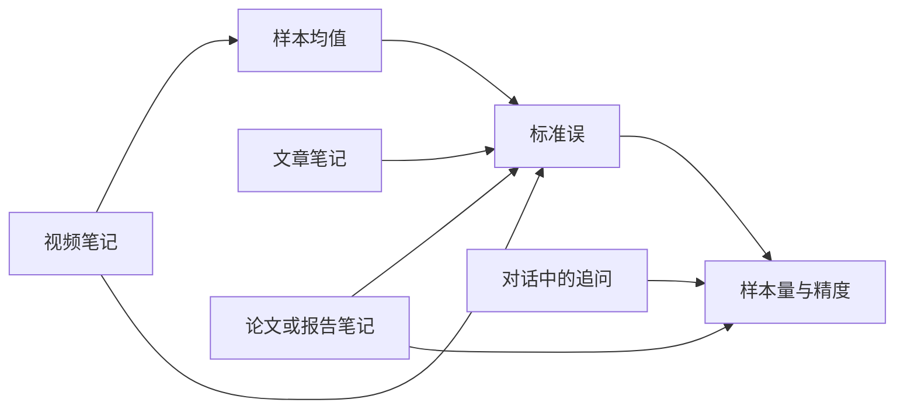

# My Second Brain

简体中文 | [English](README.en.md)

My Second Brain 是一套配合 Obsidian 和 Codex 使用的本地知识库模板，用来把不同来源中学到的概念连起来。一个视频可以拆出几个概念；同一个概念在文章、论文和对话中再次出现时，新的解释会补到已有页面上，并保留出处。

你也可以从这个网络里找接下来要学的东西。Codex 会在整理和回顾时检查概念之间的关系，寻找还没讲清的前提或方法，写成待学页。选中感兴趣的内容后，让它带你学，做几道练习，再用知识卡片复习。

## 一个视频里的概念，怎样和其他材料连起来

假设你在 B 站或 YouTube 上看了一个 20 分钟的视频，讲“为什么样本越多，估计通常越稳定”。把带时间戳的字幕交给 Codex 后，它会保留视频笔记和对应位置，并从中整理出“样本均值”“标准误”“样本量与精度”几个概念。

后来，你在 X 或微信公众号上读到一篇也在解释标准误的文章。文章里的例子可以补到原有的“标准误”页上。读论文时，可以把论文采用的假设和结果接到相应概念下。和 GPT 讨论公式时追问过的“这一步为什么成立”，也可以保留下来，核对推导后写进这页。

这样打开“标准误”，就能同时看到不同来源的解释，以及它们各自在什么条件下成立。从视频笔记出发，则能找到视频涉及的几个概念。

[统计估计示例](MOCs/统计估计.md)里有一组这样的页面。对应的短文、字幕、报告和对话都是合成教学材料，可以直接打开查看。

## 从已有知识中发现还没学过的概念

再看这个例子：你已经学过“标准误”和“样本量与精度”，也了解用同一批题比较两种方法的“配对评测”。计算误差时，这几页都需要考虑不同观测之间是否独立。在配对评测里，要检查的是不同题目的分差之间的关系。

如果现有页面只讲了独立观测的情况，Codex 在回顾时就有理由提出“相关抽样”：观测之间有关联时，原来的误差怎么算？这个学习建议来自几页共同留下的问题，你不必事先知道新概念的名字。

仓库中的[相关抽样](待学概念/数理基础/相关抽样.md)从一道题开始：

> 把每条观测复制一遍，数据行数翻倍，估计会更准吗？如果两道测试题只是同一道题的改写，它们算两份独立证据吗？

这一页解释观测之间的共同波动怎样影响误差，并把重复记录的例子算完。你可以让 Codex 从这里开始讲，再换一个条件让你试算。根据你的回答，它会继续解释卡住的地方，或把学过的内容接回正式概念页，准备复习卡片。复习中仍有疑问，也可以继续修改概念页。

这也是知识库反过来提供学习内容的方式：没有新的视频或文章时，仍可以沿着已有概念之间的问题继续学。建议可以接受、搁置或略过；学习进展根据你的解释、推导和实际应用记录。仅仅生成了一页内容，不算已经学会。

## 在 Obsidian＋Codex 中试一遍

项目是一份本地文件夹，里面有示例笔记、给 AI 的操作指南和少量工具。知识正文都是 Markdown 文件。日常在 Obsidian 中阅读和修改，在 Codex 中整理材料、讨论问题；翻卡复习时会打开一个本地网页。

1. 下载或克隆本仓库。在 Obsidian 中，把项目文件夹作为知识库打开；在 Codex 中打开同一个目录。
2. 在 Obsidian 打开[知识库入口](MOCs/知识库入口.md)，随便点开几个概念，看看它们怎样互相引用。
3. 按[从第一份材料到第一次复习](Guides/第一次使用.md)，在独立练习目录里走完整流程。它使用随仓库提供的短文和字幕，每一步都有可复制的提示，以及完成后应该看到的结果。

如果想先看看现有网络怎样支持补学，也可以把这段话发给 Codex：

> 请读 README.md 和 AGENTS.md。从“标准误”“样本量与精度”和“配对评测”中，找出与观测独立性有关的内容，说明为什么可以接着学“相关抽样”。从重复记录的例子开始讲，给我一道变式，等我回答后再继续。根据我的实际理解完善概念页，学习后再准备复习卡片。

目前有 15 篇正式概念页和一篇待学页，可以从这些路径读起：

| 阅读路径 | 涉及的概念与关系 |
| --- | --- |
| [统计估计](MOCs/统计估计.md) | 样本均值、标准误、样本量与精度，再到相关抽样 |
| [信息与预测](MOCs/信息与预测.md) | 信息熵、交叉熵、KL 散度与困惑度 |
| [文本编码与分词](MOCs/文本编码与分词.md) | UTF-8、字节级 BPE、可逆解码，以及分词怎样影响困惑度 |
| [研究与实验](MOCs/研究与实验.md) | 可检验的问题、近似反例、消融实验与配对评测 |

链接旁边会说明概念之间的关系。在 Obsidian 中，还可以用局部关系图查看一页与哪些内容相连。

## 日常怎样用

有新材料时，把链接、正文、字幕或选定的对话交给 Codex，说明你想弄清的问题。例如：

> 帮我整理这个视频。我想弄清“增加数据能改善估计”在什么条件下成立。把涉及的概念补进现有网络，保留来源，再看看有没有需要继续学的内容。

[整理材料](Prompts/整理材料.md)是这类任务的现成提示。[回顾与补学](Prompts/回顾与补学.md)用于检查已有网络里缺少的前提、尚未解释的联系，以及可以用到其他问题上的方法。选中一个建议后，用[带学新概念](Prompts/带学新概念.md)开始讲解和练习。

这些工作由你在 Codex 中发起，寻找补学内容的步骤包含在整理和回顾流程中。想定期运行，可以自行设置定时任务；模板本身没有安装后台任务。

复习时使用[每日复习](Prompts/每日复习.md)。先回想，再翻面看解释和来源。完成后，点击“导出反馈文件”，把文件交给 Codex 导入；保存成功后才会影响后续复习安排。生成复习网页需要 Python 3.9 或以上，环境检查和命令可以交给 Codex，见[工具与扩展](Guides/工具与扩展.md)。

想从自己的材料开始，可以让 Codex 在旁边创建一份空白学习目录，保留指南和工具。书籍、课程与实践记录也能接入，具体放置方式见[其他来源](Guides/其他来源.md)。链接中的正文、字幕或图片能读到多少，取决于你使用的工具；缺少的材料需要另外提供或获取。

## 为什么做这个项目

我在自己的 Obsidian 知识库里，用 Codex 整理来自不同地方的学习内容。与 GPT 的讨论是其中一个主要来源，我也希望视频、文章、论文和其他学习材料能用同样的方式接进来。遇到同一个概念时，能继续补充原有理解；回头看这些概念时，又能找到下一步要学什么。

My Second Brain 把这套做法的指南、示例和本地工具整理出来。信息论、文本编码和研究方法的示例改写自私人库中的子网络，保留了概念关系，去掉了私人对话、经历和学习记录。具体说明见[来源与许可](THIRD-PARTY.md)。

## 其他用法与扩展

有 Codex 时，也可以配合其他 Markdown 编辑器；使用 Obsidian 和其他能访问本地文件的 AI 助手时，可以让助手参考项目指南。只使用编辑器和浏览器，也能手动维护概念与链接，运行 Python 工具复习。概念发现和带学需要你自己或另行接入的 AI 完成。

笔记中的 `[[Concepts/数理基础/标准误|标准误]]` 是 Obsidian 链接。不支持它的编辑器，可以按竖线前的路径打开对应 `.md` 文件。卡片界面会直接显示来源摘录。

内容生成和带学由 AI 按指南完成。本地脚本负责检查链接、核对卡片来源，以及生成题组、保存复习反馈。工具使用 Python 标准库和随附的 KaTeX，不需要运行服务器或安装 Obsidian 插件。复习采用可调整的固定间隔，学习效果尚未评估。目录、来源类型和复习设置的调整方式见[工具与扩展](Guides/工具与扩展.md)。

个人复习记录保存在 `.flashcards/local/`，原文缓存和处理记录放在 `.local/`，需要随知识库备份。这两处已设为 Git 忽略；对外分享前，仍需检查笔记中是否包含私人内容。

项目目前是早期公开版本，项目自身的开源许可尚未确定。第三方组件沿用其原有许可。
