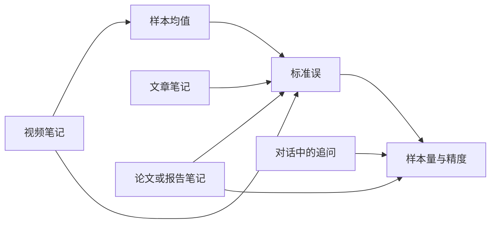

# My Second Brain

简体中文 | [English](README.en.md) · [MIT](LICENSE)

My Second Brain 是一套配合 Obsidian 和 Codex 使用的本地知识库模板。视频、文章、论文、对话和实践记录里的概念可以放到同一个网络中：一份材料提炼出多个概念，同一个概念也可以由多份材料共同补充。

已有的网络还能提供学习内容。整理或回顾时，AI 会寻找概念之间缺少的前提和方法，写成待学页。你可以选一项继续学，让它解释、出题，再用知识卡片复习。

## 材料怎样变成概念网络

假设你在 B 站或 YouTube 看了一个 20 分钟的视频，想弄清“为什么样本越多，估计通常越稳定”。整理字幕时，可以留下视频笔记和时间戳，再提炼出“样本均值”“标准误”“样本量与精度”。

后来在 X 或微信公众号读到相关解释，或者在论文中遇到同一个公式，新例子和适用条件可以补到原有概念页上。与 GPT 讨论时追问过的推导，也可以核对后保留在这里。

打开“标准误”，能看到不同来源的解释及其条件；从视频笔记出发，能找到它涉及的几个概念。[统计估计示例](MOCs/统计估计.md)可以直接试读，配套原文、字幕和对话都是合成教学材料。

## 从网络里继续学

标准误、样本量与精度，以及用同一批题比较两种方法的“配对评测”，都需要考虑不同观测之间是否独立。如果已有页面只讲了独立观测，AI 回顾时可以提出“相关抽样”，补上它们共同缺少的计算。

[相关抽样待学页](待学概念/数理基础/相关抽样.md)从这个问题开始：把每条观测复制一遍，行数翻倍，估计会更准吗？页面给出解释和完整计算，也可以让 Codex 带你做一道变式。你不必事先知道新概念的名字。

学过的内容接回概念网络，有价值的问题做成卡片；复习时发现疑问，再补充原页。即使没有新材料，也能沿着已有概念之间的问题继续学习。建议可以搁置，学习进展根据你的解释、推导或应用记录。

## 开始使用

下载或克隆仓库，让 Obsidian 和 Codex 打开同一个文件夹。Obsidian 用来读写笔记和浏览链接，Codex 用来整理与讨论；翻卡复习会打开本地 HTML 网页。

可以从[知识库入口](MOCs/知识库入口.md)看示例，也可以直接交给 Codex 一份自己的材料：

> 请读 AGENTS.md，帮我整理这份材料。我想弄清的问题是……请把涉及的概念补进现有网络，保留出处，再看看有没有值得接着学的内容。

想走一遍完整流程，参考[第一次使用](Guides/第一次使用.md)。提示可以改，材料和学习顺序也可以按需要选择。

| 示例路径 | 可以读到什么 |
| --- | --- |
| [统计估计](MOCs/统计估计.md) | 样本均值、标准误、样本量与精度、相关抽样 |
| [信息与预测](MOCs/信息与预测.md) | 信息熵、交叉熵、KL 散度与困惑度 |
| [文本编码与分词](MOCs/文本编码与分词.md) | UTF-8、字节级 BPE、可逆解码，以及分词对困惑度的影响 |
| [研究与实验](MOCs/研究与实验.md) | 可检验的问题、近似反例、消融实验与配对评测 |

目前有 15 篇正式概念页和一篇待学页。日常需要时，可参考[整理材料](Prompts/整理材料.md)、[回顾与补学](Prompts/回顾与补学.md)、[带学](Prompts/带学新概念.md)和[复习](Prompts/每日复习.md)提示。

## 读取材料用什么工具

仓库自带笔记指南、示例、链接检查和卡片工具。网页读取、字幕提取、PDF 解析与聊天历史访问由你所用的环境提供，AI 再根据读到的内容整理笔记和概念。

[来源与工具](Guides/来源与工具.md)提供一份可选清单：视频可用 yt-dlp、音频可用 Whisper，普通网页可用 Trafilatura，PDF 可用 Docling 或 MinerU。也可以继续用自己的工具，或直接提供正文、字幕和选定对话。这些提取器没有捆绑在仓库中，需要时再接入。

本地工具需要 Python 3.9 或以上，使用标准库和随附的 KaTeX，无须服务器或 Obsidian 插件。设置和命令见[工具与扩展](Guides/工具与扩展.md)。卡片采用可调整的固定复习间隔，学习效果尚未评估。

## 定期整理与维护

我在个人知识库中定期整理授权的 Codex、ChatGPT 学习对话，再回顾概念之间的联系。这依赖当前桌面环境提供的历史读取和本地写入能力，其他客户端可能需要改用导出文件或手动提供片段。

[自动整理与维护](Guides/自动整理与维护.md)说明了这套实践、可调整的提示和兼容方式，也介绍了维护公开仓库的独立任务。你可以选择合适的频率；下载模板不会自动创建任务或读取账号历史。

## 来历与其他用法

这个项目整理自我的私人 Obsidian 知识库。我希望不同来源中学到的概念能共同积累，也希望从它们的联系中找到下一步要学什么。部分示例改写自私人库中的子网络，已去除私人对话、经历和学习记录，详见[来源与许可](THIRD-PARTY.md)。

有 Codex 时可以配合其他 Markdown 编辑器；有 Obsidian 时也可以用能访问本地文件的其他 AI 助手。手动维护同样可行。目录和来源类型可以扩展，做法见[其他来源](Guides/其他来源.md)。不支持 Obsidian 双链的编辑器，可以按链接中的路径打开对应 `.md` 文件。

项目自有代码、模板、文档和示例采用 [MIT 许可证](LICENSE)。第三方组件和你导入的材料保留各自的权利与许可。个人复习记录位于 `.flashcards/local/`，原文缓存与处理记录位于 `.local/`；这两处由 Git 忽略，但仍需要备份。分享自己的知识库前，也请检查笔记正文中的私人内容。
