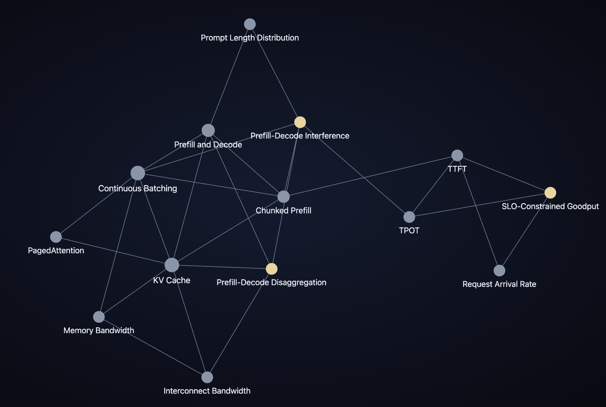
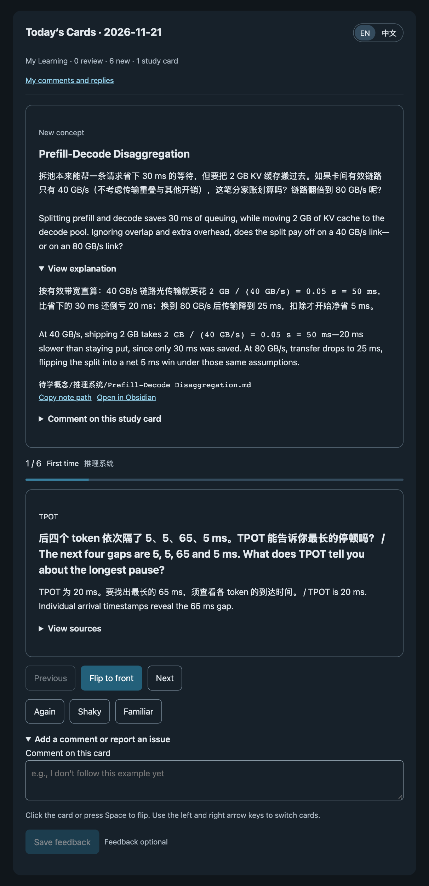
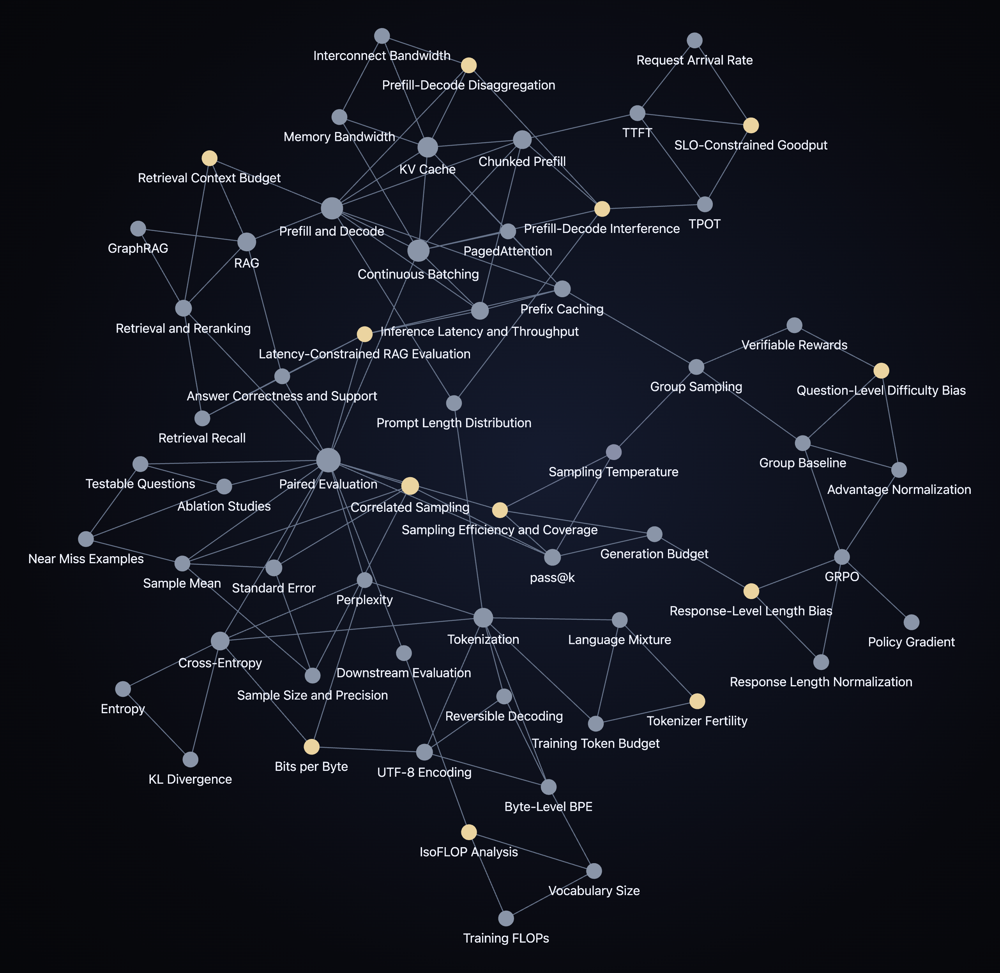

# My Second Brain

English · [简体中文](README.zh.md)

> When answers are within reach, where does judgment come from?

Two people using the same AI can look at the same material and come away with very different questions. What each person has learned along the way, and the connections they know to look for, shape where their work goes next. In research, writing, and everyday decisions, *human in the loop* means you stay the one steering—from framing what matters to judging whether an answer holds up. The more work AI can shoulder, the more your own knowledge, taste, and judgment count.

This private vault keeps formal concept notes only for what you have genuinely learned, because at heart it is a faithful map of your own knowledge—letting AI summarize things you never studied breaks that map—while study-queue pages hold candidate concepts your assistant proposes along existing links. Hand your assistant links to videos, articles, papers, or AI chats you’ve worked through; it writes concepts into plain Markdown and connects them across media and languages into a knowledge network unique to you. When you review, or run a daily schedule you set up yourself, it builds review cards from concepts you already know and can optionally pair them with a study card for one connected concept you haven’t met yet—so what you absorb strengthens the judgment you bring back to real work with AI.

[Start in 5 minutes](#start-in-5-minutes) · [Today’s cards](Guides/First-Run.md#todays-cards) · [Explore in Obsidian](Guides/Graph-View.md)

![Two glowing infinity loops meeting at an illuminated neural brain representing Your Mind. On the left, after learning from videos, articles, papers, or AI chats, you share sources with your AI assistant to build a private knowledge network and generate daily cards for reviewing learned knowledge and exploring new concepts; ratings and questions return to revise both notes and cards. On the right, a stronger mind brings sharper framing, taste, and judgment to working with AI, while execution feeds new puzzles back into learning.](assets/demo/human-ai-loop.en.png)

## How it works

1. **Share what you studied**: Paste links to videos, articles, papers, or saved AI chats—or set up an optional scheduled task to sweep selected AI learning chats. The readers return the text they can access, and your assistant connects each concept into your Markdown notes and topic maps (MOCs).
2. **Review and discover when ready**: Open your vault’s fixed private local URL to flip review cards from learned concepts—plus an optional suggested new-concept card. Clicking **Save** enters recall ratings into the local schedule (ratings on older card versions stay in history); written questions go to your assistant to answer the question, revise the card or suggest a related one. You can revisit the exchange under **My comments and replies**.
3. **Bring sharper judgment to real work with AI**: With more connected knowledge in mind, you frame clearer questions, spot shallow answers faster, and carry the puzzles you hit in real work straight into the next round of learning.

## Start in 5 minutes

Create a clean personal vault beside the downloaded template—with only the tools, prompts, and guides, and zero example clutter (requires Python 3.9+, or `py -3` on Windows):

```sh
# Create your own empty vault next to the template
python3 tools/workflow.py init ../My-Learning --empty
```

Open the new folder with your AI assistant and paste a link or file from **something you actually just studied** (a video, article, paper, or saved chat) to generate your first connected concept notes. Once you add review cards, run `Today.command` (macOS), `sh Today.command` (Linux), or `Today.cmd` (Windows) in that folder to open Today’s Cards in your browser. If you only want to peek at a populated example first, open this downloaded template directory in your editor or run its launcher directly to inspect sample cards—no need to build the example from scratch.

Notes are Markdown files on your computer. New notes use relative links, and your review history lives in a local SQLite database. Open the folder in your preferred editor or in Obsidian for its graph view. Codex, Cursor and Antigravity can read the project rules in `AGENTS.md`. Claude Code can import the same file through `CLAUDE.md`. Bringing in a chat history or reviewing cards inside a chat depends on the tools your assistant provides. If you use a cloud model, its service receives what your permissions and tools put into its context.

See the [First-use guide](Guides/First-Run.md#a-vault-of-your-own) to start your own vault, or check [Sources and tools](Guides/Sources-and-tools.md) and [Automation settings](Guides/Automation.md).

## A worked example: one week, two loops

I read in Obsidian and use Codex to maintain this vault. Over one week I studied four serving pieces—[a six-minute Bilibili video on the KV cache](https://www.bilibili.com/video/BV1jAZwBGEwi/), the WeChat essay [《预训练工程师在干什么》 (“What Do Pretraining Engineers Do?”)](https://mp.weixin.qq.com/s/Wt_HyaK98tPF39p1y6eMow), the [*Sarathi-Serve*](https://www.usenix.org/conference/osdi24/presentation/agrawal) paper, and [an AI chat with GPT on stream timing](assets/demo/streaming-dialogue.md) (a public rewrite with reset numbers)—plus [a tokenization lecture on YouTube](https://www.youtube.com/watch?v=zduSFxRajkE&t=1430s). Using the project’s built-in source readers alongside a scheduled task I set up for selected AI chats, those four serving sources converged into [the LLM serving map](MOCs/Streaming%20LLM%20Serving.md), while the YouTube lecture fed [the tokenization map](MOCs/Multilingual%20Tokenizers.md).



When you run a daily deck or pick a study note, review questions from those notes appear alongside a study card for one of the pale-gold nodes linked in the graph—here, [*prefill–decode disaggregation*](待学概念/推理系统/Prefill-Decode%20Disaggregation.md#简答). Grasping that card’s tradeoff sharpens how you read [*DistServe*](Papers/DistServe.md), and the next time you design a serving setup with AI, you already know what to ask back—starting with: once prefill and decode sit on separate GPU pools, which link actually carries the KV cache?

Ratings enter the local schedule as soon as you click **Save** (older versions keep their own rating history), and any question you leave at the fixed private URL—or in a host chat that supports interactive cards sharing the same records—is waiting for your assistant the next time it prepares cards. Open **My comments and replies** to read its answer or the card it revised or added.



[Peek at the example cards](Guides/First-Run.md#browsing-the-example-vault) · [Leave a comment on a review card](Guides/Flashcard-Review.en.md#feedback-and-saving)



[More topic maps](MOCs/Knowledge-Index.md) · [MIT license](LICENSE) · [Third-party materials](THIRD-PARTY.md) · [Feedback](https://github.com/beetlespike/My-Second-Brain/issues)
