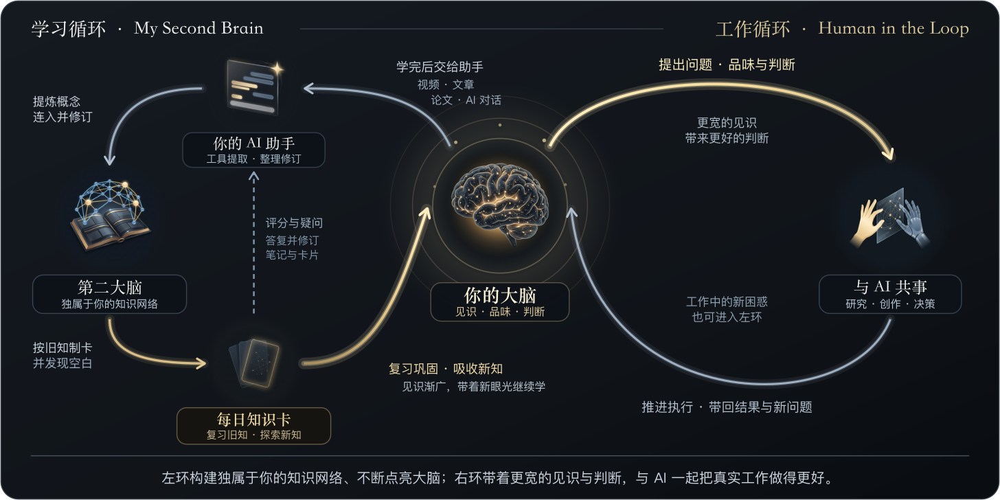
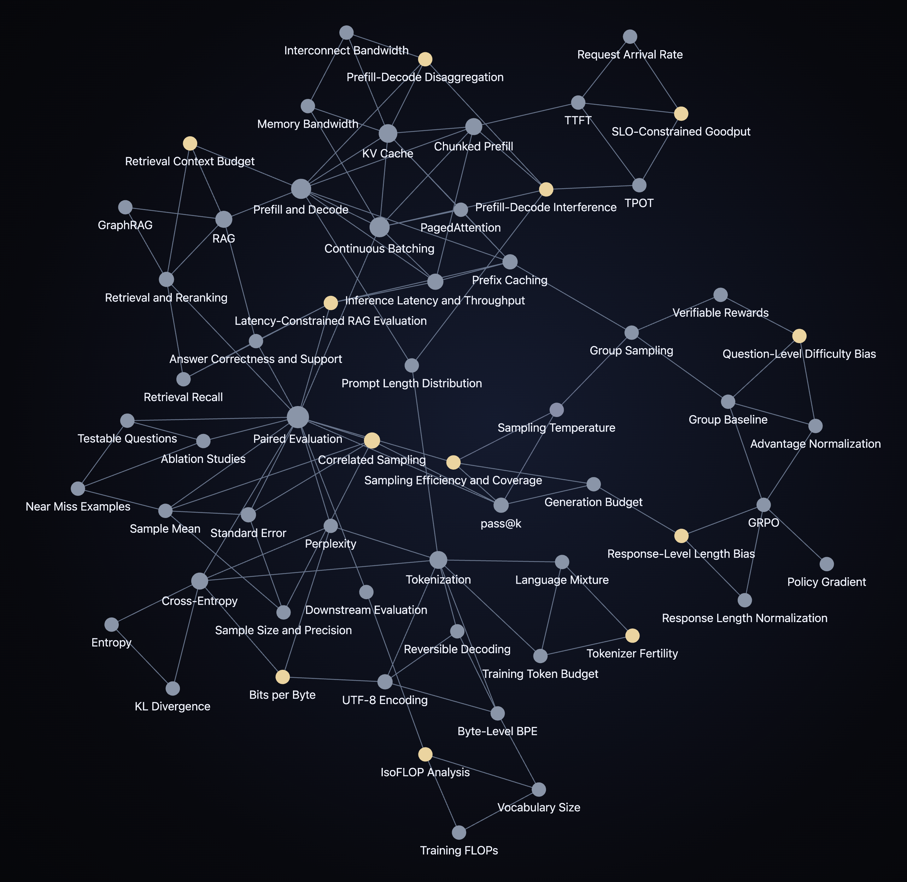

# My Second Brain

[English](README.md) · 简体中文

> 答案随手可得，判断从哪里来？

两个人用同一个 AI，面对同一份材料，也常看出完全不同的问题。一个人一路学过什么、脑海里能接上哪些联系，会悄悄决定他把工作引向何处。在研究、写作与日常判断里，*human in the loop* 意味着真正掌舵的始终是人——从提出一个像样的问题，到分辨一份答案站不站得住脚。AI 能替人做的事越多，人自己的见识、品味和判断就越发要紧。

这套私人知识库的正式概念只收录你真正学过的内容，因为它的本质，是你个人知识的一份真实映射；没学过就提前让 AI 替你整理进去，这张映射就对不上了；待学页则暂存助手顺着联系提议的候选概念。把你学过的视频、文章、论文或 AI 对话链接交给助手，它会用普通 Markdown 整理概念，跨媒介、跨语言连成独属于你的知识网络；在你复习或启用自设的每日任务时，它会把已学概念做成复习卡，并可附带一张顺着联系挑出的新知探索卡——让你吸收的新知，反过来帮你在与 AI 共事的真实工作里做得更好。

[5 分钟上手](#5-分钟上手) · [今日知识卡](Guides/第一次使用.md#今日知识卡) · [在 Obsidian 里看示例](Guides/Graph-View.md)



## 每天怎么用

1. **交给助手学过的材料**：随手贴入视频、文章、论文或 AI 对话记录，也可按需自己设定时任务定期收拢选定的 AI 学习对话。项目内置面向各类来源的读取工具，助手据此把概念连进你的 Markdown 笔记和主题地图（MOC）。
2. **翻卡巩固并可按需拓展**：打开固定的本机私人网址，复习基于已学概念的卡片，并可附上一张推荐的新知探索卡。点保存后，评分当场计入本地排期（旧版评分会留在历史里）；写下的疑问交给助手，它可以答疑、修订这张卡，或附上一张相关卡片——提问、答复和相关卡都会保留在「我的留言与回复」里。
3. **把更宽的眼光带回真实工作**：在学习循环里积累的见识与直觉，会让你在与 AI 共事时更快提出关键问题、分辨方案优劣；工作里遇上的新困惑，又顺理成章成为下一轮学习的起点。

## 5 分钟上手

在下载下来的模板旁建一个只含框架、不带作者示例的干净个人库（需要 Python 3.9+，Windows PowerShell 可用 `py -3`）：

```sh
# 在模板旁建一个空白私人库
python3 tools/workflow.py init ../My-Learning --empty
```

用你的 AI 助手打开这个新目录，贴进一条**你自己刚学过的材料**（视频、文章、论文或保存的对话），就能看着它整理出属于你的第一批概念页。做出卡片后，在目录里运行 `Today.command`（macOS）、`sh Today.command`（Linux）或 `Today.cmd`（Windows）即可在浏览器打开今日知识卡。如果你只是想先逛一圈别人养好的成品长什么样，直接用编辑器打开现在这个模板目录、或运行里面的启动器就能看到示例卡片，不必从头手推一遍示例。

笔记是电脑上的 Markdown 文件，新笔记用相对链接互相引用，复习记录存在本机的 SQLite 数据库里。用熟悉的编辑器就能读写，想逛图谱时可以用 Obsidian。Codex、Cursor 和 Antigravity 可以读取项目里的 `AGENTS.md`，Claude Code 通过 `CLAUDE.md` 导入同一份规则。在聊天里翻卡、定时读取选定的历史对话，则要看助手提供哪些工具。使用云端模型时，哪些内容会发给服务商，取决于你授权工具放入上下文的材料。

具体操作见[第一次使用指南](Guides/第一次使用.md#自己的学习库)，也可以按需查看[来源与工具](Guides/来源与工具.md)和[自动化设置](Guides/自动整理与维护.md)。

## 一个真实例子：从一周所学到真实工作

我自己用 Obsidian 阅读，用 Codex 维护这个库。这周我先后学了四份围绕推理服务的材料——B 站[讲 KV 缓存的六分钟短片](https://www.bilibili.com/video/BV1jAZwBGEwi/)、公众号文章[《预训练工程师在干什么》](https://mp.weixin.qq.com/s/Wt_HyaK98tPF39p1y6eMow)、[*Sarathi-Serve*](https://www.usenix.org/conference/osdi24/presentation/agrawal) 论文，以及与 GPT 讨论流式计时的[公开改写对话（数字已重设）](assets/demo/streaming-dialogue.md)——外加一段 [YouTube 分词课](https://www.youtube.com/watch?v=zduSFxRajkE&t=1430s)。借助项目内置的各类来源读取工具与我自设的定时任务，前四份跨语言材料汇进了同一张[推理服务地图](MOCs/Streaming%20LLM%20Serving.md)，分词课则接进了[分词地图](MOCs/Multilingual%20Tokenizers.md)。


准备每日题组或主动选入待学页时，这些旧知组成的复习题旁可以附上一张顺着图谱淡金色节点挑出的探索卡——这里选的是[「预填充与解码分离」](待学概念/推理系统/Prefill-Decode%20Disaggregation.md#简答)。从这张卡片吃透核心权衡后，再读 [*DistServe*](Papers/DistServe.md) 时一眼就能抓到重点；下次在真实工作里和 AI 一起设计推理架构，你也知道该直接追问什么——比如：拆开两组 GPU 后，KV 缓存到底要经过哪条链路？

在网页点保存，评分就立刻计入本地排期（旧版本会各自保留评分历史）；你在卡片下留下的问题——或在支持内嵌交互卡的聊天宿主（如 Codex）里提交的反馈——会留给助手在下次制卡时处理。到「我的留言与回复」里，可以读到答复、修订后的卡或新关联的卡。


[查看示例里的这组卡片](Guides/第一次使用.md#逛逛成品示例库) · [给复习卡留意见](Guides/Flashcard-Review.md#反馈与保存)



[更多主题地图](MOCs/知识库入口.md) · [MIT 许可](LICENSE) · [第三方材料](THIRD-PARTY.md) · [反馈](https://github.com/beetlespike/My-Second-Brain/issues)
