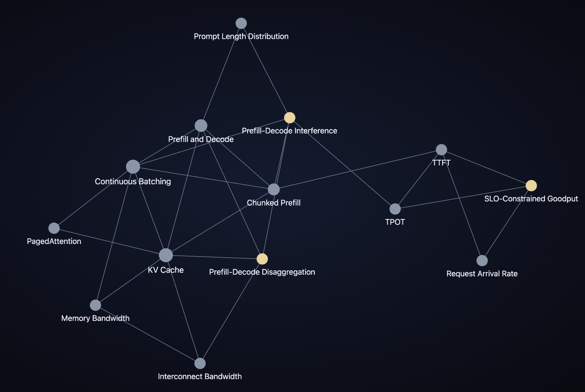
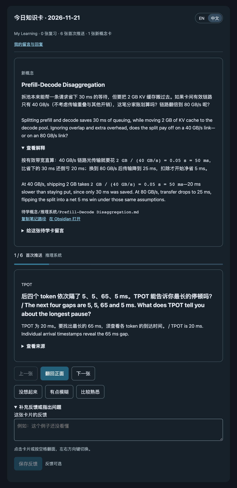

# My Second Brain

[English](README.md) · 简体中文

My Second Brain 是一套开源的本地学习框架，AI 助手把你学过的材料连成 Markdown 知识网，**自主发现你尚未补齐的关联新知，为你定制探索卡**，和复习卡一起发到同一个私人网页。

> 答案随手可得，判断从哪里来？

两个人用同一个 AI，面对同一份材料，也常看出完全不同的问题。一个人一路学过什么、脑海里能接上哪些联系，会悄悄决定他把工作引向何处。在研究、写作与日常判断里，*human in the loop* 意味着真正掌舵的始终是人——从提出一个像样的问题，到分辨一份答案站不站得住脚。AI 能替人做的事越多，人自己的见识、品味和判断就越发要紧。

这套私人知识库的正式概念只收录你真正学过的内容，因为它的本质，是你个人知识的一份真实映射；没学过就提前让 AI 替你整理进去，这张映射就对不上了；待学目录则专存助手顺着你的已有联系自主发现的候选概念。平时只需要把学过的视频、文章、论文或 AI 对话链接甩给助手，它会用纯 Markdown 整理成概念页、跨媒介跨语言连成只属于你的知识网；配好一次定时任务（或随时开口叫它一轮），助手会从近期笔记生成复习卡，遇到值得补学的概念再配一张专属探索卡，一起发布到本机固定的私人网页——让你吸收的新知，反过来帮你在与 AI 共事的真实工作里做得更好。

[5 分钟上手](#5-分钟上手) · [今日知识卡](Guides/第一次使用.md#今日知识卡) · [在 Obsidian 里看示例](Guides/关系图谱.md)


## 每天怎么用

1. **只管扔给助手学过的材料**：贴入你刚看完的视频、文章、论文或保存的 AI 对话，也可按需设好定期扫对话的任务。内置读取工具会提取可用正文，助手把新概念接进你的 Markdown 笔记与主题地图（MOC）。
2. **卡片交给助手，复习时打开书签。** 设好每日任务，平时只管贴学过的链接。助手会从近期笔记做复习卡，找到值得补学的关联概念时，再附上一张为你定制的探索卡，一起发到同一个私人网页。点保存后，当前版本的评分就进入复习排期。卡下的疑问留给助手下一次制卡时处理，答复和修订过的卡可以在「我的留言与回复」里看。
3. **把更宽的眼光带回真实工作**：在学习循环里积累的见识与直觉，会让你在与 AI 共事时更快提出关键问题、分辨方案优劣；工作里遇上的新困惑，又顺理成章成为下一轮学习的起点。

## 5 分钟上手

克隆仓库并在旁边建一个只含工具、双语提示词与指南的干净私人库：

```sh
git clone https://github.com/beetlespike/My-Second-Brain.git
cd My-Second-Brain
python3 tools/workflow.py init ../My-Learning --empty
```

*（需要 Python 3.9+，Windows PowerShell 可用 `py -3`。网页文章与本地 Markdown/文本无需额外依赖；在线视频字幕需装 `yt-dlp`，提取 PDF 的文字层需 `pdftotext`。）*

用你的 AI 助手打开 `../My-Learning`，丢进去一条**你自己刚学过的材料**即可起步。攒下两三份笔记后，设一个每日定时任务让它以后自动维护并出卡；想立刻体验，对它说一句「帮我用刚才的笔记做几张复习卡，顺便打开今日知识卡」，拿着它给出的私人网址存成浏览器书签就行（目录里的 `Today.command` / `sh Today.command` / `Today.cmd` 只是给不经聊天界面、或电脑重启后一键拉起这个本地网页服务用的）。如果只是想先翻翻现成成品，用编辑器或 Obsidian 打开下载目录里的 `examples/demo-vault/` 即可。

笔记是电脑上的纯 Markdown 文件，采用标准相对路径链接，复习记录存在本地 SQLite 数据库。用任何编辑器都能读写，想看知识图谱可用 Obsidian。Codex、Cursor 和 Antigravity 会直接读取根目录 `AGENTS.md`，Claude Code 通过 `CLAUDE.md` 导入同一份规则。是否能自动扫描历史聊天取决于客户端宿主接口；使用云端模型时，发送给服务商的内容由你授权进入上下文的工具决定。

具体操作见[第一次使用指南](Guides/第一次使用.md#自己的学习库)，也可以按需查看[来源与工具](Guides/来源与工具.md)和[自动化设置](Guides/自动整理与维护.md)。

## 一个真实例子：从一周所学到真实工作

我自己平时用 Obsidian 阅读、用 Codex 配每日自动化维护库，出卡直接在我固定的私人网页里看。这周我先后学了四份围绕推理服务的材料——B 站[讲 KV 缓存的六分钟短片](https://www.bilibili.com/video/BV1jAZwBGEwi/)、公众号文章[《预训练工程师在干什么》](https://mp.weixin.qq.com/s/Wt_HyaK98tPF39p1y6eMow)、[*Sarathi-Serve*](https://www.usenix.org/conference/osdi24/presentation/agrawal) 论文，以及与 GPT 讨论流式计时的[公开改写对话（数字已重设）](examples/demo-vault/assets/demo/streaming-dialogue.md)——外加一段 [YouTube 分词课](https://www.youtube.com/watch?v=zduSFxRajkE&t=1430s)。助手调用读取器把前四份跨语言材料汇进了同一张[推理服务地图](examples/demo-vault/MOCs/Streaming%20LLM%20Serving.md)，分词课接进了[分词地图](examples/demo-vault/MOCs/Multilingual%20Tokenizers.md)。



顺着图谱上的这些联系，助手自主发现我还没学到却正好能串起几块旧拼图的概念，并把其中一张放进了早晨的私人网页里：[「预填充与解码分离」](examples/demo-vault/待学概念/推理系统/Prefill-Decode%20Disaggregation.md#简答)。从这张探索卡吃透核心权衡后，再读 [*DistServe*](examples/demo-vault/Papers/DistServe.md) 时一眼就能抓到重点；下次在真实工作里和 AI 一起设计推理架构，你也知道该直接追问什么——比如：拆开两组 GPU 后，KV 缓存到底要经过哪条链路？

下面就是深色模式下的这个私人卡片网页（这里展示我个人中英混用库的界面，你自己的库全按你的语言习惯走）。点保存后评分立刻写入本地排期（旧版本评分各自留在历史），卡片下写下的任何问题会在助手下一次自动准备卡片时给出答复、修卡或关联新卡，结果全部保留在「我的留言与回复」里。

<p align="center"></p>

[查看示例里的这组卡片](Guides/第一次使用.md#逛逛成品示例库) · [给复习卡留意见](Guides/Flashcard-Review.md#反馈与保存)


[更多主题地图](examples/demo-vault/MOCs/知识库入口.md) · [MIT 许可](LICENSE) · [第三方材料](THIRD-PARTY.md) · [反馈](https://github.com/beetlespike/My-Second-Brain/issues)
